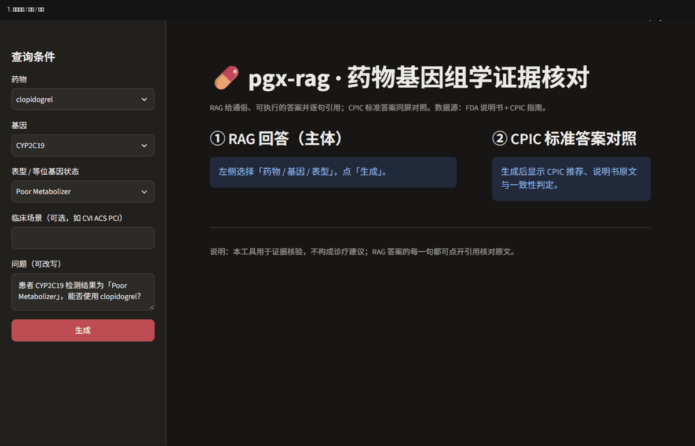

# pgx-rag · 药物基因组学证据核对 RAG

> 输入「药物 + 患者基因型/表型（+ 临床场景）」，输出一张**可核对的证据卡**：
> 通俗的 RAG 答案（逐句引用）+ CPIC 指南标准答案 + 两者的一致性判定。
> 数据源：美国 FDA 药品说明书（SPL）+ CPIC 基因-药物指南。

**不是**患者问答机器人，**不是**诊断工具。定位是**专业侧（药师/医生）的证据核验工具**。



---

## 1. 当前状态

| 阶段 | 内容 | 状态 | 完成度 |
|---|---|---|---|
| 0 | 场景 / 数据源 / 技术底座 | ✅ | 100% |
| 1 | 数据准备（抓取 + 表格抽取 + 切片） | ✅ | 100% |
| 2 | 检索层（BM25 + 向量 + RRF） | ✅ | 100% |
| 3 | 生成层（引用 + 证据分级 + 拒答） | ✅ | 100% |
| — | **双源证据卡**（指南 + 说明书 + 一致性） | ✅ | 90%（缺人工抽验） |
| — | **CPIC 数据层**（结构化入库） | ✅ | 100% |
| — | **Streamlit Demo** | ✅ | 100% |
| — | **核心评测**（RAG vs CPIC 金标准） | ✅ | 85% |
| 4 | FastAPI + SSE + 引用高亮页 | 🔄 | 40%（仅 Streamlit 演示） |
| 5 | 评测固化（三项自动指标 + 药师盲评） | 🔄 | 55% |
| 6 | 履历包装 | ⬜ | 0% |
| — | NMPA 中文说明书（三方差异） | ⏸ | 0%（地域限制，回大陆再做） |

### 可核对的数字

| 指标 | 结果 |
|---|---|
| 语料 | **2722 切片**（FDA 说明书 2416 + CPIC 指南 306），178 张表格 / 1844 行 |
| 检索 | 7 问评测 **R@5 = 1.000、MRR = 0.929**（混合召回） |
| 生成 | 7/7 通过、引用覆盖率 90%、平均 3.3s、拒答 0.24s |
| 核心评测 | 80 题（CPIC 机械生成）**转述一致率 86.5%** |
| 留出实验 | 同批 42 题：含指南 **88.6%** → 剔除指南切片后 **54.2%**（量化了循环性） |
| 证据卡巡检 | 50 个基因-药对：一致 9 / 指南更严 1 / 说明书更保守 1 / 说明书未收录基因 2 |

---

## 2. 架构

```
问题（药 + 基因型/表型 + 场景）
  │
  ├─ 检索路径（RAG 主体）
  │   说明书 2416 + CPIC 306 切片
  │     ├─ BM25（基因符号/等位基因/剂量词精确命中）
  │     └─ 向量（text-embedding-v4，1024 维，中文原文直编）
  │           → RRF 融合 → 单药过滤 → 章节权威度惩罚 → top_k
  │   证据分级 A/B/C/D → DeepSeek 生成（逐句 [n] 引用）→ 引用回填校验
  │
  └─ 对照路径（标准答案）
      MySQL 直查 CPIC：cpic_pair + cpic_recommendation + cpic_gene_result
      → 推荐原文 + 强度(Strong/Moderate/Optional) + 检测建议 + 场景
        ↓
     一致性判定：一致 / 指南更严格 / 说明书更保守 / 说明书未收录该基因
```

LangGraph 编排：`retrieve → assess ─┬→ refuse → finalize`
                                     `└→ generate → finalize`

---

## 3. 技术栈

| 层 | 选型 |
|---|---|
| 环境与依赖 | **uv**（`pyproject.toml` + `uv.lock`），Python 3.12 |
| 分层 | `app/{api,agent,clients,conf,core,entities,models,prompt,repositories,scripts,services}` |
| 配置 | YAML + dataclass + **OmegaConf** + python-dotenv（密钥走 `.env`） |
| 日志 | **loguru**（文件轮转 + 控制台） |
| 元数据库 | **MySQL 8.0**（Docker，宿主 3307）+ SQLAlchemy 2.0 async + asyncmy |
| 向量库 | **Qdrant 1.16**（Docker，6333；也支持嵌入式） |
| 向量化 | **DashScope `text-embedding-v4`**（1024 维，多语言）；目标形态 TEI + bge-large-zh-v1.5 |
| 关键词检索 | **自实现 BM25**（基因/等位基因友好分词 + 字段加权） |
| 文档解析 | **lxml**（SPL HTML → 行列矩阵：rowspan/colspan、内联脚注、图片占位表） |
| 生成 | **DeepSeek**（OpenAI 兼容），逐句引用 + 证据分级 + 拒答 |
| 编排 | **LangGraph**（条件分支） |
| 演示 | **Streamlit** |

---

## 4. 快速开始

```powershell
# 1) 环境
uv sync

# 2) 基础服务（需要 Docker Desktop）
docker compose -f docker/docker-compose.yaml up -d mysql qdrant
docker compose -f docker/docker-compose.yaml ps

# 3) 数据入库
uv run python -m app.scripts.init_meta_db      # 说明书写入 MySQL
uv run python -m app.scripts.ingest_cpic       # CPIC 写入 MySQL
uv run python -m app.scripts.build_cpic_chunks # 指南原文转检索语料
uv run python -m app.scripts.build_index       # BM25 + 向量索引

# 4) 自检
uv run python -m app.scripts.check_services

# 5) Demo
uv run streamlit run app/api/streamlit_app.py   # http://localhost:8501

# 6) 命令行
uv run python -m app.scripts.card --drug clopidogrel --phenotype "Poor Metabolizer" --context "CVI ACS PCI"
uv run python -m app.scripts.ask "CYP2C19 慢代谢型患者用氯吡格雷会怎样？"
```

---

## 5. 主要脚本

| 脚本 | 作用 |
|---|---|
| `app/scripts/init_meta_db.py` | 建表 + 灌入 17 药 / 17 说明书 / 2416 切片 / 178 表 |
| `app/scripts/ingest_cpic.py` | 抓取并入库 CPIC（50 pair / 247 推荐 / 70 表型解读 / 6271 星型映射） |
| `app/scripts/build_cpic_chunks.py` | CPIC 推荐转成可检索语料（306 条） |
| `app/scripts/build_index.py` | 建 BM25 + 向量索引（支持 `--server` / `--no-dense`） |
| `app/scripts/card.py` | 生成证据卡（JSON / 可读文本） |
| `app/scripts/ask.py` | RAG 问答（走 LangGraph，可 `--no-graph`） |
| `app/scripts/eval_retrieval.py` | 检索评测（BM25 / 向量 / 混合） |
| `app/scripts/eval_generation.py` | 生成验收（拒答正确性 / 引用覆盖 / 越界引用） |
| `app/scripts/eval_gold.py` | **核心评测：RAG 答案 vs CPIC 金标准**（LLM 盲判方向） |
| `app/scripts/eval_card.py` | 证据卡巡检（50 个基因-药对的一致性分布） |
| `app/scripts/check_services.py` | 服务健康检查 |

---

## 6. 关键设计决策（都来自实测）

1. **表格单独解析成行列矩阵**：CYP2C19 四表型的 Cmax/IPA/VASP-PRI 全在表格里，切碎后无法检索也无法引用。
2. **SPL 的 `<footnote>` 从单元格抽出编号 `[n]`**：内联脚注会把脚注正文糊进表头。
3. **多标签择优**：内容丰富度分档 > 单方 > 口服 > 命中次数 > 表格数 > 生效日期（否则他克莫司会选到 2017 年、不提 CYP3A5 的标签）。
4. **表格分块按字符预算**（含表头/脚注占用），只按行数切会出现 6835 字符的块。
5. **首列行组标签向下补全**：切分后第二段会丢 `VASP-PRI` 参数名。
6. **同药文本指纹去重**：OpenFDA 把同一段文字放进多个字段（丢掉 219 条冗余）。
7. **混合召回用 RRF**：余弦 0–1 与 BM25 0–∞ 量纲不同，不能加权求和。
8. **章节权威度惩罚**：患者版说明书会复述黑框警告，纯相似度会把它排第一。
9. **单药自动过滤**：说明书互相引用（泮托拉唑标签里也提氯吡格雷）。
10. **重排默认关闭**：gte-rerank 实测把 MRR 从 0.929 拉到 0.707。
11. **先判证据、再决定是否调模型**：D 级直接拒答（236ms），不依赖模型是否听话。
12. **证据卡必须带临床场景**：同一表型在 ACS/PCI 是 Strong、非 ACS 是 Moderate。
13. **指南原文也进检索语料**：只用说明书时 56% 的表型问题会答"说明书未定义该表型"。

---

## 7. 评测口径（重要，别写错）

**这里有两个数字，含义不同，不能混用：**

| 指标 | 值 | 测什么 |
|---|---|---|
| **转述一致率** | 86.5%（80 题） | 语料**含** CPIC 原文时，系统能否正确检索并转述权威依据 |
| **留出一致率** | 54.2%（42 题，剔除指南切片） | 拿掉金标准来源后的泛化能力（对照组合 88.6%） |

- 题目由 CPIC **机械生成**，金标准取自 CPIC 推荐原文；
- RAG 链路不看 CPIC 表结构，只做检索 + 生成；方向由 **LLM 盲判**（不提供金标准）后比对；
- 档位：0 标准剂量 / 2 调整或监测 / 3 避免或禁用；
- **循环性问题已量化**：把 4 个药的 182 条 CPIC 切片从语料剔除后，同一批题从 88.6% 掉到 54.2%，
  说明 86.5% 衡量的是「检索 + 转述」，**不是独立医学推理正确率**；详见 [reports/eval_holdout.md](reports/eval_holdout.md)；
- 简历写法：分开写「转述一致率」与「留出一致率」，并注明后者不循环。**不要**写成一个笼统的"准确率"。

---

## 8. 已知限制

| 限制 | 说明 |
|---|---|
| 只有 17 个药 | CPIC 里与这些基因相关的 A 级药共 51 个，本项目取代表性子集；架构支持增量扩药 |
| **NMPA 拿不到** | `nmpa.gov.cn` 对非大陆 IP 返回 412（阿里云 WAF JS 挑战）+ 地域限制；实测出口 IP 在澳门 |
| 无患者个体信息 | 无年龄/肝肾功能/合并用药 → 不能判断"能不能吃" |
| 无药师评审 | 目前没有外部专业评审，可信度需靠后续盲评补齐 |
| ES/TEI 未启用 | 已写编排未启动，当前用自研 BM25 + 云端 embedding 替代 |
| 图片型图表已丢弃 | `<rendermultimedia>` 数据在图中，无法从 HTML 恢复 |

---

## 9. 目录

```
pgx-rag/
├── app/                    # 分层源码
│   ├── agent/graph.py          LangGraph 工作流
│   ├── api/streamlit_app.py    Demo 页面
│   ├── clients/                cpic / embedding / vector / mysql
│   ├── conf/app_config.py      YAML + dataclass + OmegaConf
│   ├── core/                   text / pgx / query / bm25 / evidence / logger
│   ├── entities/               schemas / drugs
│   ├── models/orm.py           SQLAlchemy 模型
│   ├── prompt/loader.py        提示词加载
│   ├── repositories/           chunk / keyword
│   ├── scripts/                见上表
│   └── services/               retrieval / generation / evidence_card / answer_judge
├── conf/app_config.yaml
├── docker/                 # MySQL / Qdrant / ES / Kibana / TEI 编排
├── data/                   # corpus / raw / index / eval
├── docs/                   # 项目计划书、演示素材
├── legacy/                 # 旧实现归档
├── prompts/                # 提示词
└── reports/                # 各阶段报告
```

---

## 10. 相关文档

- [项目计划书（供评审）](docs/项目计划书.md)
- 阶段 1 数据报告：[reports/stage1_report.md](reports/stage1_report.md)、[预览页](reports/stage1_preview.html)
- 检索报告：[reports/stage2_retrieval.md](reports/stage2_retrieval.md)
- 证据卡巡检：[reports/stage2_evidence_card.md](reports/stage2_evidence_card.md)
- 生成验收：[reports/stage3_generation.md](reports/stage3_generation.md)
- 核心评测：[reports/eval_gold.md](reports/eval_gold.md)
- **留出实验（量化循环性）**：[reports/eval_holdout.md](reports/eval_holdout.md)
- 会话交接：[HANDOFF-pgx-rag.md](HANDOFF-pgx-rag.md)
